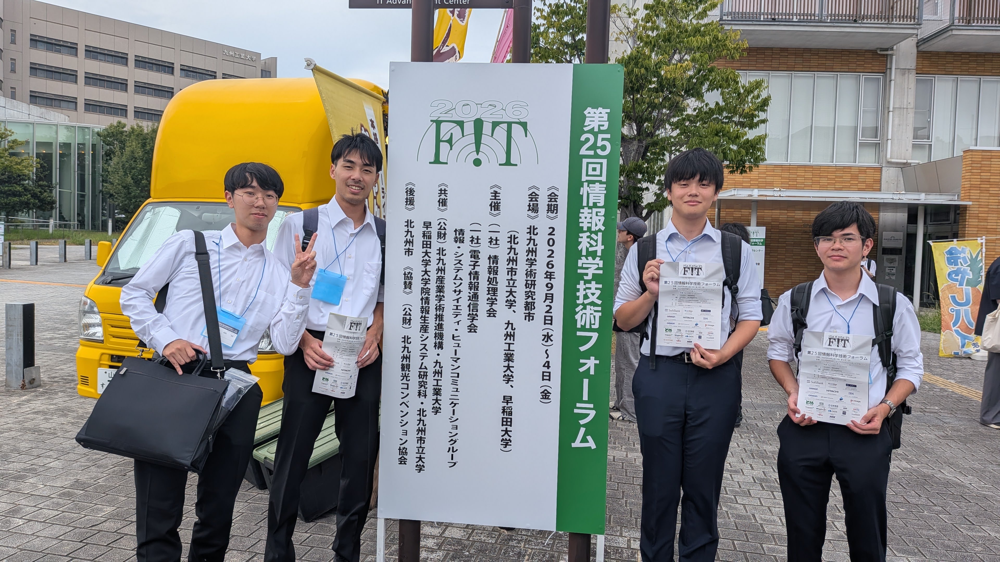
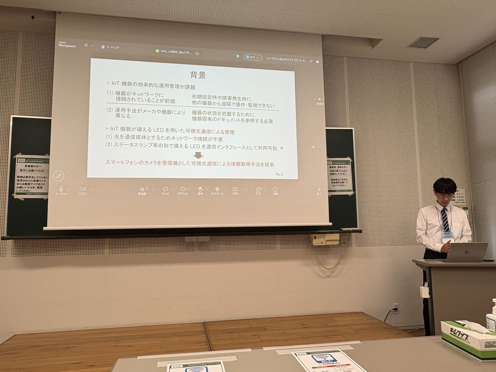
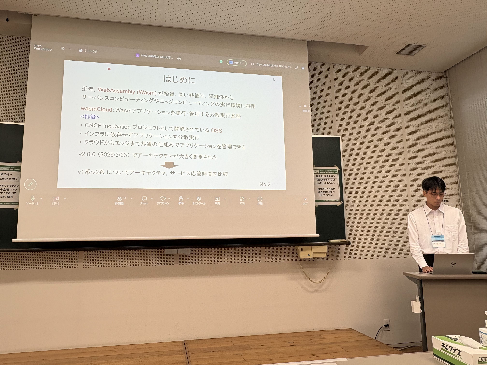
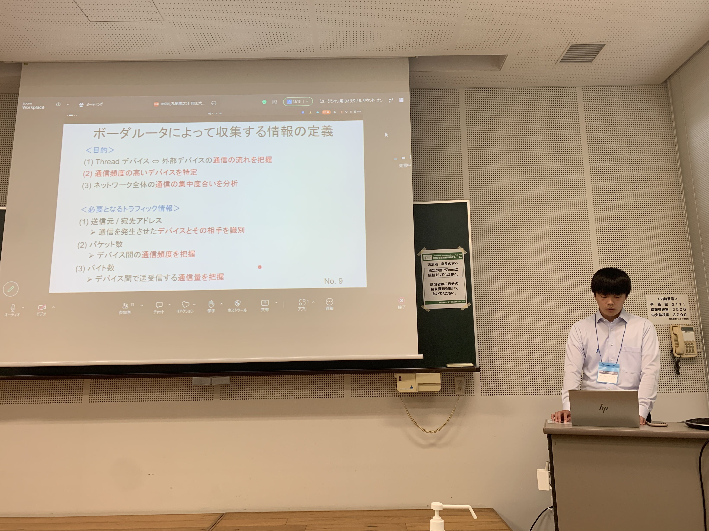
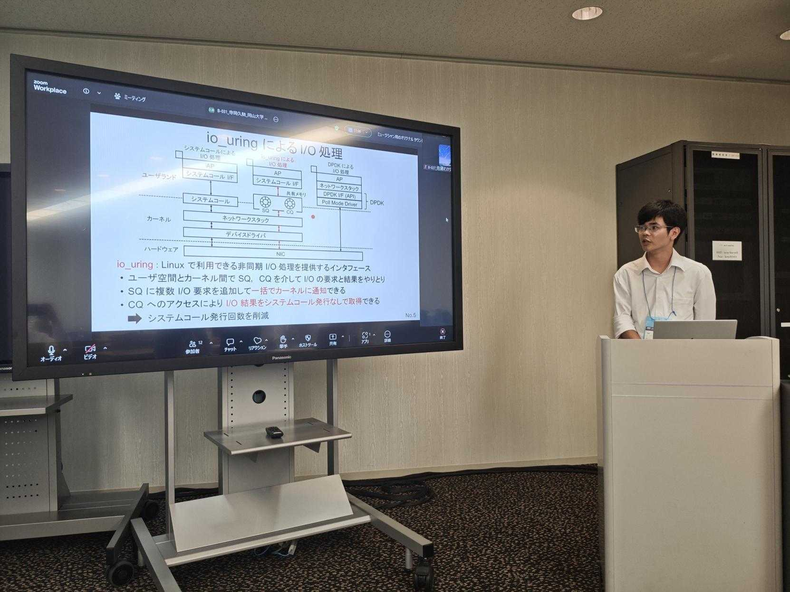

+++
date = '2026-10-28T15:29:24+09:00'
draft = false
title = 'FIT2026に参加しました'
showAuthor = true
authors = ['teraoka-h']
+++

こんにちは．M1 の寺岡です．

ご報告が遅くなりましたが，2026年 9月2日(水) ~ 9月4日(金) に開催された[第25回情報科学技術フォーラム (FIT2026)](https://www.ipsj.or.jp/event/fit/fit2026/index.html) に
M1の上田，加地，丸尾，寺岡が参加しました．

今回の FIT は，福岡県の北九州学研都市で行われました．
M1の4名全員が初めての学会発表でした．

4人全員が最終日の9/4(金)での発表だったため，9/3日(木)に現地に移動した後，
その日の午後は各々興味のある分野のセッションに赴いて聴講をしました．
この日は雨が降っていたため，広大な敷地の学研都市の中を移動するのがとても大変でした...

そして，発表当日！
非常に緊張しましたが，大きなトラブルもなく皆順調に発表を行えたと思います．

発表を終えた後は，福岡名物のもつ鍋を頂きました！
とても美味しかったことに加えて，肩の荷が降りたこともあり，箸が止まりませんでした．

最後に，寺岡は奨励賞を受賞しました．
今回の発表で学んだことを活かし，今後の研究に励みたいと思います！
