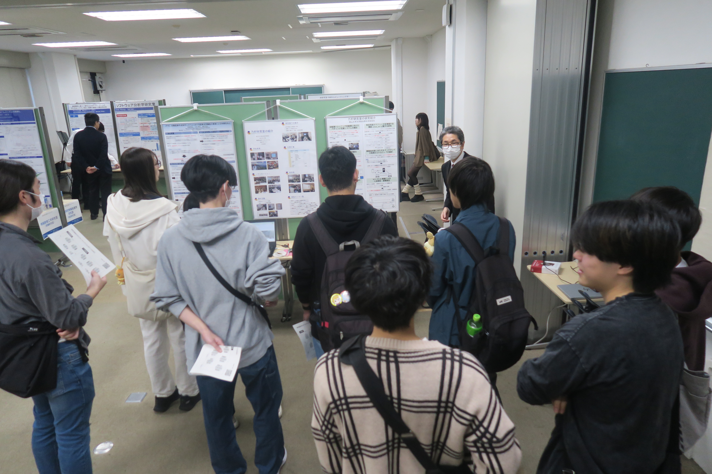

+++
date = '2026-11-09T14:19:49+09:00'
draft = false
title = '2026年度ホームカミングデイ'
showAuthor = true
authors = ['hamazaki']
+++

こんにちは！B4 の濱崎です．

10月31日 (土) に行われたホームカミングデイにて，研究室紹介を行いました．
今年は第11講義室を入ってすぐ目の前が乃村研のスペースだったということも関係しているのか，たくさんの学部生の方が話を聞きに来てくださいました！

今年のポスターは研究室紹介，研究紹介，そして M2 の大槻さんの自動証跡作成保存システムに関する研究の3枚を設置していました．

すでに研究テーマのために構想を練っている方や，研究室がどんな雰囲気なのか今のうちから知っておきたいという2年生の方もいたりして，僕自身も刺激を受けてもっと頑張ろうと思えました．

初めて自分の研究のデモを行う場でしたが，準備段階から先生や先輩方のご指導のおかげで，当日は特にトラブルなくデモを行えました．

{{< carousel images="{IMG_9042.JPG,IMG_9058.JPG,IMG_9031.JPG}" >}}

見学に来ていただいた皆さん，当日は休日にもかかわらずお越しいただきありがとうございました！
乃村研に興味を持っていただいた方は，ぜひ研究室の見学にも来てください！
